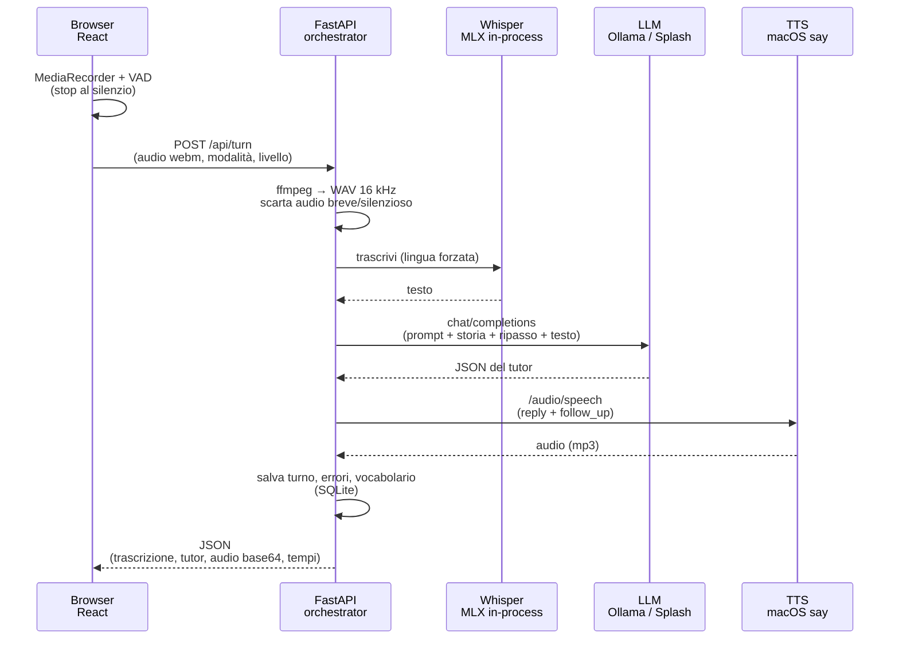

# tutor-local: descrizione tecnica

Tutor vocale italiano → inglese, **interamente locale**: ascolta (Whisper), ragiona (LLM), parla (TTS).
Questo documento serve a chi riprenderà il progetto: architettura, contratti, decisioni (con i dati che le hanno motivate),
limiti noti e strada per le evoluzioni. Stato al momento della scrittura: MVP funzionante usato dal committente su un
MacBook Pro M3 Max (36 GB).

---

## 1. Principi di progetto

1. **Local-first**: nessun dato lascia la macchina. Tutti i servizi sono processi locali.
2. **Orchestrator, non agente**: il backend decide il flusso (STT → LLM → TTS); l'LLM non sceglie strumenti. Una sola chiamata
   LLM per turno: prevedibile, veloce, facile da testare.
3. **Provider intercambiabili**: LLM e TTS parlano API OpenAI-compatible; cambiare modello o server = cambiare variabili d'ambiente.
4. **Si misura prima di scegliere**: STT e LLM sono stati scelti con benchmark riproducibili (§10), non a sensazione.
5. **Il benchmark usa lo stesso prompt dell'app** (tranne la persona «Alex»), così i risultati valgono per il prodotto reale.

## 2. Architettura



| Componente | Tecnologia | Dove gira | Note |
|---|---|---|---|
| Interfaccia | React 18 + Vite | Browser | `App.jsx` (stato) + `components/` + `hooks/` + `vad.js` |
| Orchestrator | FastAPI + uvicorn (Python ≥ 3.11) | Processo locale, porta 8010 | Serve anche il frontend compilato |
| STT | `mlx-whisper`, `whisper-large-v3-turbo` | In-process nel backend (GPU Apple) | Alternativa: endpoint OpenAI-compatible |
| Pronuncia | Wav2Vec2 XLSR-53 (CTC) + `phonemizer`/espeak-ng | In-process nel backend (PyTorch MPS) | Solo ripetizione: score 0–100, IPA atteso/predetto (§8) |
| LLM | Gemma 4 26B-A4B (Ollama) — alternativa Qwen3.6-35B-A3B (Splash) | Server separato | `LLM_BASE_URL`, `LLM_MODEL` |
| TTS | `openai-macos-stt-tts` basato su `say` e voci macOS | Servizio locale separato, porta 5050 | Facoltativo; voce selezionata separatamente per IT/EN |
| Memoria | SQLite (`data/tutor.db`) | File locale | Turni, errori, vocabolario, coda di ripasso |

Tempi misurati nell'app (turno tipico, Gemma 26B-A4B): **STT ≈ 0,55 s · LLM ≈ 0,9-1,1 s · TTS ≈ 1,0 s → ≈ 2,6 s** dalla fine
del parlato alla voce del tutor. Un outlier a 6,9 s (LLM) è compatibile con il ricaricamento del modello da parte di Ollama
dopo il timeout di inattività (vedi §12). Il controllo di pronuncia richiede **~0,1 s** dopo il primo caricamento del modello
fonetico (~4 s a freddo).

## 3. Struttura del repository

```
backend/
  requirements.txt            dipendenze complete e bloccate (include mlx-whisper, solo Apple Silicon)
  requirements-core.txt       senza mlx-whisper (Linux/Docker, STT_BACKEND=openai)
  requirements-dev.txt        dipendenze di sviluppo (pytest, ruff)
  ruff.toml                   linting (E/F/I, righe fino a 120 caratteri)
  app/
    main.py                   rotte HTTP, gestori d'errore globali, CORS, mount del frontend compilato
    orchestrator.py           flusso del turno (STT→LLM→TTS→memoria)
    modes.py                  prompt di sistema per modalità + persona + blocco di ripasso
    schemas.py                modelli Pydantic: TutorOutput, TurnResponse, ripasso, riepilogo
    config.py                 variabili d'ambiente (.env) → Settings
    memory.py                 SQLite: storia, errori, vocabolario, coda di ripasso, riepilogo
    review.py                 scheduler puro del ripasso (versione semplificata di SM-2)
    errors.py                 eccezioni applicative con stato HTTP (LLM/STT/TTS/output)
    jsonparse.py              estrazione robusta del JSON dall'output dell'LLM (senza dipendenze)
    phonetics.py              valutazione fonetica Wav2Vec2 XLSR-53 su MPS (§8)
    providers/stt.py          ffmpeg, filtro silenzio, backend mlx | openai
    providers/llm.py          client chat/completions, retry sul JSON non valido
    providers/tts.py          client /audio/speech
  tests/                      suite pytest (parser, memoria, prompt, orchestrator, API)
frontend/
  src/App.jsx                 stato, orchestrazione API/registrazioni, layout
  src/utils.js                helper e costanti (hint modalità, reviewSpeechText)
  src/hooks/useAudioPlayer.js riproduzione sequenziale clip base64
  src/components/             Sidebar, TopBar, Composer, TurnExchange, HelpPanel, ReviewPanel, PronunciationFeedback
  src/vad.js                  VAD a energia (stop automatico al silenzio)
  src/styles.css              tema chiaro/scuro + feedback fonetico (--pf-*)
llm_bench/                    benchmark LLM per il compito del tutor (§11)
phonetic_bench/               verifica ambiente e benchmark della valutazione fonetica (§8, §11)
deploy/                       Dockerfile e compose (bozze non testate, §13)
docs/TECHNICAL.md             questo file
GUIDA-STUDENTE.md             guida pratica per lo studente (funzioni ed esempi)
run.sh                        avvio in un solo processo
.env.example                  tutte le variabili configurabili
```

## 4. Flusso di un turno (dettaglio)

`orchestrator.run_turn(session_id, mode, level, spoken_lang, text|audio, speak)`:

1. **Ingresso**: se c'è `text` lo si usa così; se c'è `audio` → `stt.transcribe`. Nessuno dei due → `EmptyInput` (HTTP 400).
2. **STT** (`providers/stt.py`):
   - ffmpeg converte il contenuto (webm/mp4 del browser) in WAV 16 kHz mono 16 bit (via file temporanei).
   - `audio_stats` calcola durata e RMS. Se `durata < AUDIO_MIN_SECONDS` (0,4 s) o `RMS < AUDIO_MIN_RMS` (0,004) → testo vuoto
     → `EmptyInput("non ho sentito nulla: riprova")`. Motivo: Whisper su silenzio/clip brevissime inventa frasi («Thank you.»,
     «Grazie.») — osservato nei test.
   - Backend `mlx`: `mlx_whisper.transcribe(..., language=spoken_lang, condition_on_previous_text=False)`, serializzato da un
     `asyncio.Lock` (una sola trascrizione alla volta sulla GPU). Backend `openai`: POST multipart a `/audio/transcriptions`.
3. **Prompt**: `modes.app_system_prompt(mode, level, spoken_lang)` (§7) + storia (`memory.history(session, mode)`, ultimi
   `HISTORY_TURNS`=6 turni, dove l'assistente è rappresentato dal proprio JSON per mantenere il formato). In conversazione e
   scenario si aggiunge `modes.review_addendum(memory.review_context())`: al massimo 3 errori e 3 vocaboli scaduti, da
   riusare solo se nasce l'occasione. Il blocco è aggiunto dall'orchestrator dell'app, quindi il benchmark non lo vede.
4. **LLM**: `llm.tutor_reply` → `chat/completions` non in streaming, con `response_format: json_object` (se `LLM_JSON_MODE=1`)
   e `reasoning_effort: "none"`. Parsing con `extract_json` (toglie `<think>…</think>`, code fence, testo attorno) e validazione
   Pydantic. Se fallisce: **un** retry con «Reply again with ONLY the JSON object»; se la risposta era troncata
  (`finish_reason == "length"`) l'errore dice che probabilmente il thinking è attivo. Il JSON include `suggested_reply`, un esempio conciso di risposta dell'allievo alla domanda successiva.
5. **Normalizzazione**: `tutor.is_correct = not tutor.corrections`. Il modello a volte mette `is_correct=false` senza correzioni
   (2 casi su 48 nei test): per l'allievo conta solo ciò che viene mostrato.
6. **TTS** (se `speak` e `TTS_BASE_URL`): si pronuncia `reply` + `follow_up` (in conversazione e scenario; in traduzione il
  `follow_up` è una nota in italiano e non si legge). Se `speak_explanations` è attivo, le spiegazioni vengono segmentate:
  testo italiano con `language=it`, contenuto tra virgolette con `language=en`; le clip sono riprodotte in sequenza dopo la risposta. `providers/tts.py` invia `model`,
  `input`, `voice`, `language`, `speed` e `response_format` all'endpoint OpenAI-compatible `/audio/speech`. La velocità scelta
  si applica ai segmenti inglesi; i segmenti italiani usano sempre `1.0`. `openai-macos-stt-tts`
  mappa `voice` alle voci di sistema disponibili e usa `language` (`it`/`en`) per la sintesi con `say`. Un errore del TTS non
  fa fallire il turno (log + risposta senza audio).
7. **Persistenza** e risposta (`TurnResponse`): il turno, le correzioni e i vocaboli vengono salvati; ogni correzione e ogni
   vocabolo nuovo entra anche in `review_items` con scadenza immediata (o aggiornata, senza duplicati).

## 5. API HTTP

Base: `http://127.0.0.1:8010`. Nessuna autenticazione (solo localhost, §14).

| Metodo | Percorso | Corpo | Risposta |
|---|---|---|---|
| GET | `/api/health` | — | `{llm:{base_url,model}, stt_model, tts_enabled}` |
| POST | `/api/turn` | `multipart/form-data`: `session_id`, `mode` (`conversation`\|`scenario`\|`translate`), `level` (A2…C1), `spoken_lang` (`en`\|`it`), `text?`, `audio?` (file), `speak?` (bool, default true), `speak_explanations?` (bool, default false), `tts_speed?` (0.3, 0.7, 1.0 default 1.0) | `TurnResponse` |
| POST | `/api/translate` | JSON `{text, target:"it"\|"en"}` | `{translation}` (non salva nulla) |
| POST | `/api/help` | `multipart/form-data`: `session_id`, `text?` oppure `audio?` (domanda in italiano), `tts_speed?` (default 1.0) | `HelpResponse` (risposta italiana, `audio_b64` + `audio_segments` per le parti in inglese, timings; non persistita) |
| POST | `/api/speak` | JSON `{text, lang, speed?}` (speed default 1.0) | `{audio_b64, audio_mime}` |
| POST | `/api/pronunciation-check` | `multipart/form-data`: `target` (frase inglese attesa), `audio` (registrazione) | `PronunciationCheck` (`score`, `matched_phones`, `total_phones`, `expected_ipa`, `predicted_ipa`, `short_target`, `verdict`, `ops`, `words`, `issues`) |
| GET | `/api/vocab` | — | elenco `{term, translation_it, example, first_seen, seen}` |
| GET | `/api/mistakes` | — | elenco `{ts, session, original, corrected, type, explanation_it}` |
| GET | `/api/review/due?limit=10` | — | `ReviewQueue` (`items`, `due_count`, `total`); `limit` 1…50 |
| GET | `/api/review/stats` | — | `{due_count, total}` per il badge della UI |
| POST | `/api/review/grade` | JSON `{id, result}` con `result` 0…3 | `{item, due_count, total}`; `404` se l'elemento non esiste |
| GET | `/api/session/{session_id}/summary` | — | `SessionSummary` (turni, modalità, correzioni e vocaboli deduplicati) |

`TurnResponse`:

```json
{
  "session_id": "uuid", "mode": "conversation", "transcript": "i went to milan last week",
  "tutor": {
    "is_correct": true, "corrected_sentence": "…",
    "corrections": [{"original":"…","corrected":"…","explanation_it":"…","type":"grammar"}],
    "reply": "That sounds wonderful!", "suggested_reply": "I had a relaxing day, thanks!",
    "new_vocab": [{"term":"…","translation_it":"…","example":"…"}],
    "follow_up": "What was your favourite place?"
  },
  "audio_b64": "…", "audio_mime": "audio/mpeg",
  "explanations_audio_segments": [],
  "timings": {"stt": 0.55, "llm": 0.98, "llm_tok_s": 64.7, "tts": 1.05}
}
```

Errori: `400` input non valido o nulla da trascrivere; `502` LLM/STT/TTS non raggiungibile, risposta HTTP non valida o JSON
non conforme; `500` problemi locali (ffmpeg assente, STT mal configurato). Il messaggio è in `detail` e il frontend lo mostra.
I provider traducono timeout, errori di connessione e risposte HTTP non valide nelle eccezioni di `errors.py`
(`LLMUnavailable`, `STTUnavailable`, `TTSUnavailable`, `ModelOutputError`); `main.py` le gestisce con handler globali, così il
messaggio dice quale servizio ha fallito. In `llm_bench` le stesse eccezioni restano errori del singolo caso, senza interrompere
il benchmark. `llm_tok_s` = token generati / tempo LLM totale (include il prefill: sottostima la velocità pura).

`POST /api/pronunciation-check` valuta la registrazione in inglese con il motore fonetico (§8): confronta l'IPA decodificato dall'audio con quello atteso del testo. La risposta (`PronunciationCheck`) contiene `score` (0–100), `matched_phones`/`total_phones` (conteggio effettivo delle unità allineate), `expected_ipa` e `predicted_ipa`, più i campi introdotti in Fase 5:
- `short_target` (bool) e `verdict` (`"ok"` | `"dubbio"` | `"da_rivedere"` | `null` per target lunghi);
- `ops`: lista delle operazioni DP di allineamento (`match`, `sub`, `ins`, `del`);
- `words`: dettaglio per parola con `word`, `expected_ipa`, `heard_ipa`, `score`, `ops`;
- `issues`: al massimo 2 consigli deterministici in italiano ordinati per gravità (`word`, `expected`, `heard`, `tip_it`, `severity`).

Audio breve/silenzioso → 400 `EmptyAudio`; audio oltre `PHONETIC_MAX_SECONDS` → 400 `AudioTooLong`. È un confronto fonetico automatico, non una valutazione dell'accento o della prosodia.

`POST /api/help` trascrive l'eventuale audio forzando l'italiano, passa gli ultimi turni `conversation` al LLM come contesto e
chiede una risposta JSON segmentata per lingua: `{"segments": [{"lang": "it|en", "text": "..."}]}`. Le parti inglesi vengono
sintetizzate con la voce inglese e quelle italiane con la voce italiana; la prima clip finisce in `audio_b64`, le successive in
`audio_segments` e la UI le riproduce in sequenza. Se il modello non produce il JSON, si usa un retry e poi un fallback che
riconosce virgolette, righe inglesi e traduzioni tra parentesi. Il turno di aiuto non viene salvato in SQLite e non cambia
modalità, sessione o cronologia di pratica.

## 6. Modello dati (SQLite, `DB_PATH`, default `data/tutor.db`)

```sql
turns(id, ts, session, mode, transcript, tutor_json)            -- storia; tutor_json = TutorOutput serializzato
mistakes(id, ts, session, original, corrected, type, explanation_it)
vocab(term PRIMARY KEY, translation_it, example, first_seen, seen)  -- term in minuscolo; seen++ se si ripresenta
review_items(id, kind, source_key, prompt, answer, hint, due, interval_days, ease, repetitions, lapses,
             last_result, created, last_reviewed, UNIQUE(kind, source_key))
```
Le tabelle si creano da sole. La storia è filtrata per `session` **e** `mode`. `review_items` raccoglie sia gli errori sia i
vocaboli: `kind` è `mistake` o `vocab`, `source_key` evita duplicati, `due` è un timestamp Unix. Una migrazione idempotente
(`PRAGMA user_version`, versione 1) crea/backfilla la coda dai dati già presenti in `mistakes` e `vocab`, quindi un database
esistente continua a funzionare senza interventi manuali.

Il ripasso usa una versione semplificata di SM-2 (`review.py`): «Non ricordato» riporta l'elemento in coda dopo circa 10 minuti,
«Difficile»/«Bene»/«Facile» aumentano l'intervallo e regolano l'ease (limitato tra 1,3 e 3,0). La programmazione è una funzione
pura e testata; `memory.grade_review` calcola e salva la nuova scadenza.

Il blocco di ripasso nel prompt resta volutamente leggero: al massimo 3 errori e 3 vocaboli scaduti, ordinati per frequenza e
scadenza, con l'istruzione di creare un'occasione naturale e di non trasformare il dialogo in un test. Il riepilogo di sessione
legge i turni salvati e deduplica correzioni e vocaboli, senza una seconda chiamata all'LLM.

## 7. Prompt e contratto JSON

### 7.1 Schema (stesso per tutte le modalità: un solo parser)
`is_correct`, `corrected_sentence`, `corrections[]` (`original`, `corrected`, `explanation_it`, `type` ∈ grammar | vocab |
preposition | word_order | false_friend | other), `reply`, `suggested_reply`, `new_vocab[]` (`term`, `translation_it`, `example`), `follow_up`.

### 7.2 Modalità (`modes.py`)
- **conversation**: tutor di inglese per un italiano adulto al livello CEFR scelto. Regole chiave: correggere solo errori
  reali; **l'input è una trascrizione automatica** (non correggere punteggiatura/maiuscole, ignorare errori di riconoscimento);
  se l'allievo parla italiano o chiede «come si dice» non è un errore: dare la frase inglese e chiedere di ripeterla; restare
  nel ruolo di tutor; `corrected_sentence` deve applicare tutte le correzioni; la risposta (parlata) è di 1-3 frasi, senza
  elenchi/markdown e senza ripetere le spiegazioni, che sono a schermo; `suggested_reply` è un esempio breve di risposta
  dell'allievo alla domanda più recente, non una frase pronunciata dal tutor; spiegazioni in italiano; max 2 vocaboli nuovi.
- **scenario**: come conversation + `SCENARIO_EXTRA`. *Preparazione*: 4-6 frasi utili in `new_vocab` (`term` = frase inglese,
  `translation_it`, `example` = alternativa/risposta probabile) e una `reply` che presenta la situazione e propone il gioco di
  ruolo. *Gioco di ruolo*: il tutor recita l'altra persona (es. receptionist), risposte brevi, corregge gli errori. `max_tokens`
  = 900 in questa modalità.
- **translate**: traduce IT↔EN fedelmente in `reply`; `follow_up` = al massimo una nota in italiano.
- **Persona** («Alex, un tutor AI che gira in locale») aggiunta solo da `app_system_prompt`; `system_prompt` (usato dal
  benchmark) non la contiene, così la cache del benchmark non si invalida per una questione cosmetica.
- **Ripasso**: `review_addendum(context)` è un blocco aggiunto dall'orchestrator solo in conversazione e scenario. Non fa parte
  di `system_prompt`/`SCHEMA` e non entra nell'impronta del benchmark: i risultati di `llm_bench` restano confrontabili.

### 7.3 Regola d'oro quando si tocca un prompt
Qualsiasi modifica a `CONVERSATION`/`SCHEMA` cambia l'impronta (hash) dei risultati del benchmark: i vecchi risultati vengono
rieseguiti e il report segnala «⚠ risultati con prompt diverso». Dopo ogni modifica rilancia `llm_bench` (set base + `cases_hard.json`).
L'aggiunta di `suggested_reply` cambia prompt e schema: i risultati precedenti non misurano la qualità dei suggerimenti e vanno rigenerati prima di confrontare modelli.

## 8. Configurazione (variabili d'ambiente / `.env`)

| Variabile | Default | Significato |
|---|---|---|
| `LLM_BASE_URL` | `http://localhost:11434/v1` | Endpoint OpenAI-compatible (Ollama; Splash: `http://127.0.0.1:8000/v1`) |
| `LLM_MODEL` | `gemma4:26b` | Nome del modello (Splash: `mlx-community/Qwen3.6-35B-A3B-4bit`) |
| `LLM_API_KEY` | `local` | Ignorata dai server locali |
| `LLM_TEMPERATURE` | `0.4` | |
| `LLM_MAX_TOKENS` | `700` | Tetto di generazione (scenario: 900) |
| `LLM_JSON_MODE` | `1` | `response_format: json_object`; metti `0` con Splash o se il server lo rifiuta |
| `LLM_EXTRA_BODY` | `{"reasoning_effort":"none"}` | Campi extra del payload. **Spegne il thinking** (vedi §10.2); `{}` lo lascia acceso |
| `STT_BACKEND` | `mlx` | `mlx` (in-process) o `openai` |
| `STT_MODEL` | `mlx-community/whisper-large-v3-turbo` | Backend `mlx` |
| `STT_BASE_URL`, `STT_API_KEY`, `STT_API_MODEL` | — / `local` / `whisper-1` | Backend `openai` |
| `STT_INITIAL_PROMPT` | vuoto | Vocabolario di contesto per Whisper (es. termini tecnici) |
| `AUDIO_MIN_SECONDS`, `AUDIO_MIN_RMS` | `0.4`, `0.004` | Filtro anti-silenzio prima di Whisper |
| `PHONETIC_MODEL` | `facebook/wav2vec2-xlsr-53-espeak-cv-ft` | Checkpoint Wav2Vec2 per la valutazione fonetica della pronuncia |
| `PHONETIC_DEVICE` | `mps` | Device PyTorch (`cpu` se MPS non è disponibile) |
| `PHONETIC_MAX_SECONDS` | `20.0` | Limite massimo durata clip audio per prevenire picchi memoria/latenza su MPS |
| `PHONETIC_SHORT_MAX_UNITS` | `8` | Soglia massima di unità fonetiche per attivare la modalità bersaglio breve (`verdict`) |
| `TTS_BASE_URL` | vuoto | URL base del servizio locale, es. `http://127.0.0.1:5050/v1`. Vuoto = nessun audio |
| `TTS_API_KEY` | `local` | Token inviato come Bearer; il servizio locale non lo usa per autenticarsi |
| `TTS_MODEL` | `tts-1` | Campo richiesto dal protocollo; il servizio `say` lo accetta per compatibilità |
| `TTS_VOICE_IT`, `TTS_VOICE_EN` | `alloy`, `alloy` | Nomi delle voci configurate/mappate dal servizio; devono corrispondere a voci macOS installate |
| `TTS_FORMAT` | `mp3` | `mp3` (richiede ffmpeg) oppure `wav` |
| `DB_PATH` | `data/tutor.db` | |
| `HISTORY_TURNS` | `6` | Turni passati all'LLM |

### Servizio TTS locale

Il provider TTS di tutor-local è compatibile con il servizio locale `openai-macos-stt-tts`: non richiede modifiche applicative. Avvia il servizio sulla stessa macchina, abilita HTTP nel suo `.env` (`USE_HTTP=True`) e configura `TTS_BASE_URL` in tutor-local. `TTS_VOICE_IT` e `TTS_VOICE_EN` selezionano le voci mappate dal servizio; installa in macOS voci appropriate per entrambe le lingue. Non è necessario caricare un modello neurale o campioni WAV.

Il servizio usa `say` di macOS, quindi deve restare sull'host Mac e non può essere eseguito in un container Linux. Mantenerlo raggiungibile solo in locale: non espone autenticazione.

La velocità della voce inglese si seleziona dalla barra laterale e accetta solo `0.8`, `0.9`, `1.0`, `1.1` o `1.2`. Il backend invia il valore OpenAI-compatible `speed` per `language=en`; per `language=it` invia sempre `1.0`.

### Motore fonetico della pronuncia

La valutazione fonetica della ripetizione (roadmap §15.1) userà `facebook/wav2vec2-xlsr-53-espeak-cv-ft`
(316 M parametri, ~1,2 GB) su PyTorch MPS. Dipendenze aggiunte e bloccate in `requirements*.txt`:
`torch==2.14.1`, `transformers==5.22.2`, `phonemizer==3.6.0`. `phonemizer` è richiesto dal tokenizer del
modello (`Wav2Vec2PhonemeCTCTokenizer`) già al caricamento. Dipendenza di sistema aggiuntiva: `espeak-ng`
(`brew install espeak-ng`; su Linux il pacchetto `espeak-ng`), oltre a `ffmpeg`.

Pipeline: l'IPA atteso viene da `phonemizer` (testo → espeak `en-us`) attraverso `tokenizer.phonemize()`,
che separa già i singoli fonemi; quello predetto dalla decodifica CTC dell'audio a 16 kHz. Il greedy
longest-match usato in fase 1 è stato rimosso perché confondeva token come `ju`/`uː`. Prima del confronto
si normalizzano lunghezza (`ː`, `ˑ`) e allofoni noti (`ɹ→r`, `ɾ→t`, `ᵻ→ɪ`, `ɐ→ə`), poi si applica una
Levenshtein **pesata sui simboli IPA atomici**: una sostituzione tra due vocali costa 0.5, tutto il resto
1.0. Così le differenze di qualità vocalica dovute all'accento pesano meno degli errori consonantici
(`θ→t`, `ð→d`) e delle parole mancanti. Score = `1 − distanza / len(atteso)`, arrotondato 0–100.

`phonetic_bench/check_env.py` verifica la pipeline su audio sintetico espeak-ng (in-domain): **95/100**.
La voce macOS `say` è fuori dominio (32/100) e **non** va usata come riferimento. `phonetic_bench/run_bench.py`
misura invece il parlato umano reale (`stt-bench/recordings/mac`, accento italiano):

| misura | risultato | gate |
|---|---|---|
| frasi pulite en01–en11 | mediana **69**, min 47 | ≥ 60 e min ≥ 40 |
| coppie minime pron01–pron08 | **7/8** ordinate, delta mediano **+33.5** | ≥ 7/8 e delta ≥ 10 |
| perturbazione (testo senza ultima parola) | **11/11** peggiorano, drop mediano **+8** | ≥ 9/11 e drop ≥ 5 |
| latenza (clip ~5 s, dopo warm-up) | mediana **~0.12 s**, max ~0.16 s | < 1 s |
| memoria | **~1.26 GB** MPS allocati, ~750 MB RSS | solo misura |

Il gate di 90 resta valido solo per l'audio sintetico in-domain: sul parlato accentato con errori reali
(confermati da Whisper: en06 `Thursday→Tuesday`, en07 finali, en09 nomi propri) la baseline è ~69. I gate
relativi sono la prova che il motore discrimina; lo score assoluto non è calibrato come un giudizio umano.
Risultati con impronta di modello/frasi/audio in `phonetic_bench/results/bench.json` e `report.md`.

Verifica end-to-end dell'endpoint (fase 4, `POST /api/pronunciation-check` reale con la registrazione `en02`): 200 con
score **82**, `matched_phones` 39/47; **3,9 s a freddo** (include download/caricamento del modello) e **0,10 s a caldo**;
memoria **~1,26 GB** MPS allocati, ~2,2 GB driver, ~590 MB RSS.

Il modulo `app/phonetics.py` espone `evaluate_pronunciation(target, audio, lang)` (score 0-100, numero di
fonemi, IPA atteso/predetto), `text_to_ipa`, `audio_to_phonemes` e le funzioni pure `normalize`,
`canonical`, `ipa_symbols`, `distance`, `score` (testate senza modello). `matched_phones` è una stima
derivata dallo score (`round(total_phones × score / 100)`): lo score lavora sui simboli IPA atomici, il
totale sui fonemi tokenizzati, quindi i due conteggi non coincidono sempre. Modello e processor si caricano
alla prima chiamata e le inferenze sono serializzate da un lock; l'audio breve/silenzioso solleva
`EmptyAudio` (HTTP 400). Dalla fase 3 l'endpoint `/api/pronunciation-check` usa direttamente questo modulo
(§5); il vecchio confronto lessicale (`app/pronunciation.py`) è stato rimosso.

## 9. Frontend

### 9.1 Struttura dei sorgenti

```
src/
  App.jsx                 # stato, chiamate API, registrazioni (orchestrator UI)
  main.jsx                # entry Vite
  utils.js                # MODE_HINTS, MODE_LABEL, reviewSpeechText
  vad.js                  # VAD a energia
  styles.css              # layout + tema + variabili --pf-* (feedback fonetico)
  hooks/
    useAudioPlayer.js     # play/stop di clip base64 in sequenza
  components/
    Sidebar.jsx           # modalità, livello, microfono, ascolto, nuova sessione
    TopBar.jsx            # titolo modalità, help, ripasso
    Composer.jsx          # ● Parla + campo testo + errori
    TurnExchange.jsx      # un turno (bolle, correzioni, practice, vocab)
    HelpPanel.jsx         # drawer «Chiedi in italiano»
    ReviewPanel.jsx       # drawer ripasso + riepilogo sessione
    PronunciationFeedback.jsx  # score/verdetto/chip/tips IPA
```

`App.jsx` resta il contenitore dello stato e della logica audio/API (quattro flussi di
registrazione: turno, practice, help, review). I componenti in `components/` sono
prevalentemente presentazionali: ricevono props e callback, senza fetch diretti.
Aggiungere una nuova area UI = nuovo file in `components/` + montaggio in `App.jsx`.
Il feedback fonetico usa variabili CSS `--pf-*` definite in `:root` e sovrascritte
nel tema scuro, così tip e chip restano leggibili in light e dark.

- **Layout**: barra laterale a sinistra con le opzioni (modalità, livello o lingua, microfono, solo ascolto, nuova sessione) e a destra la chat
  (conversazione dall'alto verso il basso con scorrimento automatico, compositore con «● Parla» e campo di testo in basso). Sotto gli 820 px la
  barra diventa un pannello a scomparsa (☰). I drawer di ripasso e aiuto sopra i 1000 px sono **affiancati** nel layout (`flex: 1` per la chat, drawer a larghezza fissa) impedendo che i messaggi o il compositore vengano coperti; sotto i 1000 px aprono come overlay con scrim oscurato e chiusura rapida con tasto `Esc` o clic esterno. Chiaro/scuro automatico (`prefers-color-scheme`). Solo CSS puro, nessuna libreria di UI.
- **Stato** (React hooks): sessione (UUID, «Nuova sessione» lo rigenera), modalità, livello, impostazioni audio, turni, errori.
  Le callback asincrone (fine registrazione, fine riproduzione) leggono le impostazioni correnti da un `ref` (`cfg`), per evitare
  closure obsolete.
- **Registrazione**: `getUserMedia` (echo cancellation + noise suppression) → `MediaRecorder` (webm/opus; mp4 su Safari — il
  backend decodifica da contenuto, non dall'estensione) → `POST /api/turn`. Il microfono richiede `localhost` o HTTPS.
- **VAD** (`vad.js`): rilevatore a energia, senza dipendenze né modelli. I primi 400 ms calibrano il rumore di fondo; «voce» =
  RMS > max(0,015; 3 × rumore). Si ferma dopo `pausa` secondi di silenzio *dopo* aver sentito voce, o dopo 10 s senza voce,
  o dopo 90 s. Pausa selezionabile (1,5 / 2,5 / 4 s; 4 s per chi parla lentamente). Verificato in simulazione (tempi di stop,
  pause a metà frase più corte della soglia, rumore costante); **non ancora collaudato con un microfono reale**.
  Limite noto: una pausa di esitazione più lunga della soglia taglia la frase.
- **Conversazione continua**: a fine riproduzione del tutor riparte la registrazione; un errore o «Nuova sessione» la interrompe.
- **Aiuti per l'ascolto**: «Ascolta di nuovo», «Traduci» (`/api/translate`), «Solo ascolto» (testo nascosto finché non si clicca),
  🔊 per ogni frase suggerita nello scenario (`/api/speak`).
- **Velocità inglese**: selettore nella sidebar sinistra (0,8×, 0,9×, 1,0×, 1,1×, 1,2×); non modifica il parlato italiano.
- **Risposta suggerita**: mostra `suggested_reply`, una possibile frase dell'allievo per rispondere alla domanda del tutor. «Ascolta e prova a rispondere» riproduce e confronta questo testo con `/api/pronunciation-check`. La frase corretta mantiene un'azione separata «Ascolta frase corretta». Il risultato viene mostrato tramite il componente `PronunciationFeedback`:
  - sui **target brevi** (`short_target: true`): niente percentuale ingannevole; verdetto qualitativo con icona (`✓ Ci sei`, `~ Dubbio`, `✗ Da rivedere`), righe IPA atteso/udito allineate tramite `ops` (simboli sostituiti/omessi/inseriti evidenziati) e riepilogo testuale delle differenze;
  - sui **target lunghi**: badge score secondario, chip colorati per singola parola con stato (`ok`, `dubbio`, `da rivedere`) espandibili con click per vedere atteso, udito e tip specifico, più i primi due suggerimenti globali (`issues`).
- **Aiuto contestuale**: il pulsante «Chiedi in italiano» nella barra superiore apre un drawer destro con input testuale e microfono dedicato. La route `/api/help` riceve la domanda, e domanda/risposta restano nel pannello senza entrare nella timeline persistita o interrompere la pratica. La risposta è segmentata per lingua: le parti inglesi usano la voce inglese, quelle italiane la voce italiana.
- **Ripasso**: «🔁 Ripasso» apre un drawer con il badge degli elementi scaduti. Mostra un elemento alla volta (errore o vocabolo),
  «Mostra risposta», i quattro voti (Non ricordavo / Difficile / Bene / Facile) e, sotto, il riepilogo della sessione corrente
  (turni, correzioni, vocaboli). Il badge si aggiorna all'avvio e dopo ogni turno; gli elementi votati escono subito dalla coda.
  Dopo la risposta si può ascoltare la forma corretta (`/api/speak`) e ripeterla con `/api/pronunciation-check`, come nella pratica
  della frase suggerita; il confronto è fonetico (score e IPA).
- **Nuova sessione**: oltre a resettare chat e testi, ferma le registrazioni in corso (turno e pratica), mette in pausa l'audio e
  azzera ripasso/aiuto/stato occupato. Le risposte asincrone di una sessione precedente vengono ignorate.
- Il frontend mostra la «frase corretta» solo se ci sono correzioni.

## 10. Benchmark e registro delle decisioni

Tutti i dati sono di **un solo parlante** (italiano, accento naturale) su insiemi piccoli: indicano una tendenza, non una verità
statistica. Differenze di 1-2 parole o di 1 caso non sono significative.

### 10.1 STT (progetto `stt-bench`, 40 frasi it/en + 8 coppie di pronuncia)
| Motore | WER italiano | WER inglese (accento italiano) | Note |
|---|---|---|---|
| **Whisper large-v3-turbo (MLX)** | **≈ 5,6 %** (≈ 7,3 % su clip < 30 s) | 19,2 % | regge clip di 38 s; RTF 0,07 |
| Gemma 4 E4B (MLX 4 bit) | ≈ 13,2 % (≈ 9,6 % su clip < 30 s) | 22,1 % | **tronca in silenzio oltre 30 s** (it20: 78 % delle parole) |
| `openai-macos-stt-tts` (Apple Speech) | ≈ 15,8 % | — | sbaglia di più i termini tecnici |

_I WER sono stime calcolate dai report su sottoinsiemi di frasi leggermente diversi (si sono escluse le registrazioni difettose): vale l'ordine di grandezza, non la seconda cifra._

Altri risultati: Gemma E4B non è un valutatore di pronuncia (chiesto quali parole erano sbagliate: **0/8** distinzioni corrette,
falsi allarmi su tutte le take corrette); la traduzione EN→IT con Gemma E4B è inaffidabile; i modelli «normalizzano» spesso la
parola attesa invece di quella pronunciata (≈ metà dei casi) — nessun vantaggio netto di Gemma. **Decisione**: Whisper turbo.
Whisper su silenzio/clip brevissime inventa testo → filtro anti-silenzio (§4).

### 10.2 LLM (`llm_bench`, 28 casi base + 20 difficili)
- **Incidente del thinking**: il primo giro dava 29 % di JSON validi: 21 risposte su 28 troncate esattamente a `max_tokens`
  (900) perché il ragionamento nascosto consumava il budget. Rimedio: `reasoning_effort: "none"` (vale per Ollama `/v1` e
  Splash; `think:false` viene ignorato su `/v1`). Dopo: 100 % valide, 0 troncate.
- Risultati con thinking spento (set base 28 casi): **Gemma 4 26B-A4B** 20/20 errori corretti, 0/8 falsi allarmi, **2,3-2,5 s**,
  88-92 tok/s; **Qwen3.6-35B-A3B** (Splash) 19/20 (incoerenza tra `corrected_sentence` e correzioni su un caso), 0/8,
  **1,1-1,2 s**, ≈ 180 tok/s; **Qwen3.8-27B** 20/20, 4,5 s, 54 tok/s, risposte verbose che ripetono le correzioni.
- Set difficile, primo giro (Gemma e Qwen3.6, prompt precedente): 10/10 errori e 6/6 controlli per entrambi; letti a mano: Gemma interpreta meglio il contesto con trascrizioni imperfette,
  Qwen3.6 si fa deviare di più e ha qualche scivolone in italiano. Caso `a01` (vera trascrizione sbagliata di Whisper):
  dopo le regole aggiunte al prompt Gemma non inserisce più gli errori di riconoscimento tra le correzioni, ma risponde ancora «German» per «Gemma»: unico fallimento (16/17) con i punteggi ricalcolati.
- **Decisione**: Gemma 4 26B-A4B (Ollama) come predefinito per affidabilità con trascrizioni imperfette; Qwen3.6-35B-A3B su
  Splash come alternativa più veloce (cambia solo `LLM_BASE_URL`/`LLM_MODEL`). Splash: motori MoE possono dare output diversi tra
  run a temperatura 0; serve un modello alla volta in memoria (36 GB).

### 10.3 Valutazione fonetica della pronuncia (`phonetic_bench`)
- **Motore scelto**: `facebook/wav2vec2-xlsr-53-espeak-cv-ft` (Wav2Vec2 XLSR-53 CTC, 316 M parametri) su PyTorch MPS.
- **Riferimento = testo, non audio TTS**: `phonemizer`/espeak `en-us` produce l'IPA atteso. Su audio espeak-ng in-domain lo
  score è **95/100**; sulla voce macOS `say` è **32/100** (fuori dominio per il modello), quindi `say` non è un riferimento valido.
- **Perché non Whisper/difflib**: il confronto lessicale non vede i singoli fonemi (es. `ship`/`sheep`, `think`/`sink`); il
  motore fonemico distingue i suoni e restituisce uno score 0–100 più le sequenze IPA.
- **Scoring e allineamento (Fase 5.1)**: Levenshtein pesata calcolata con programmazione dinamica e backtrace (`align`), che attribuisce operazioni `match`, `sub`, `ins`, `del` a ciascuna parola. I dittonghi (`DIPHTHONGS = {"oʊ", "aɪ", "eɪ", "aʊ", "ɔɪ"}`) sono trattati come unità atomiche e non spezzati: la monottongazione comune per i parlanti italiani (`oʊ→o`) costa 0.5 anziché 1.0 (sostituzione vocale anziché cancellazione intera). Questo sposta lo score di riferimento per la registrazione umana `en02` da **82 a 84** (distanza 8.0 su 49 unità fonetiche).
- **Bersagli brevi e verdetto qualitativo (Fase 5.4b)**: per frasi/parole con unità ≤ `PHONETIC_SHORT_MAX_UNITS` (default 8), la percentuale è ingannevole: nel caso *tower/towel* (`t aʊ əl` pronunciato `t a b ɔ l`), la sola sostituzione consonantica `ʊ→b` portava uno score 70 (apparentemente "verde"). La funzione pura `verdict(ops)` assegna invece `ok` (nessuna differenza), `dubbio` (solo differenze vocale-vocale) e `da_rivedere` (errori consonantici, omissioni o inserzioni), senza mostrare percentuali.
- **Consigli deterministici in italiano (Fase 5.3)**: `app/phonetic_tips.py` contiene una tabella di matching per pattern tipici dell'italiano (omissione di `h`, confusione di `θ`/`ð`, suffissi `-ed` o consonanti finali omesse, vocali parassite tipo *istreet* o *doga*). Nessuna chiamata LLM: matching offline istantaneo, max 2 consigli ordinati per gravità con tono prudente.
- **Misure su 11 frasi umane** (accento italiano): mediana **69** (min 47); coppie minime **7/8** con delta mediano **+33.5**;
  perturbazione **11/11** con drop mediano **+8**; latenza a caldo **~0.12 s**; memoria **~1.26 GB** MPS allocati / ~2.2 GB driver.
- **Gate tarati**: mediana ≥ 60 e min ≥ 40; coppie ≥ 7/8 e delta ≥ 10; perturbazioni ≥ 9/11 e drop ≥ 5; latenza < 1 s. Il gate
  di 90 resta valido solo per l'audio sintetico in-domain.
- **Limiti noti**: un solo parlante; `cat/cut` non distinto in una take; lo score assoluto non è calibrato come un giudizio
  umano; il motore non valuta accento né prosodia. L'italiano è fuori v1 (modello fine-tunato sull'inglese).

## 11. Strumenti di test

- **`llm_bench`** (dalla cartella, con il venv del backend): `python run_llm_bench.py --models <nome>` (set base),
  `--cases cases_hard.json` (set difficile, risultati in `results/cases_hard/`). Il report include **tutti** i modelli con
  risultati; `--models` decide solo cosa eseguire. I risultati sono salvati con un'impronta (prompt + parametri + testo del caso):
  cambiando prompt o parametri si rieseguono da soli; il punteggio si ricalcola dal testo salvato, quindi modificare
  `scoring.py` non richiede nuove chiamate.
- **Aggiungere un caso**: in `cases*.json` un oggetto con `id`, `text`, `error` e `must_have_any`/`must_not` (correzione attesa
  nella frase corretta) oppure `checks` (più controlli indipendenti per frasi con più errori); `asr_noise` +
  `forbidden_originals` + `reply_must_not` per le trascrizioni sbagliate; `manual: true` per i casi da leggere a mano.
  Semantica del punteggio: «corretto» = nessuna correzione mostrata (come nell'app).
- **`stt-bench`** (progetto separato): `record.py` (registra le frasi dal microfono) e `run_bench.py` (WER/CER per categoria,
  clip lunghe, test di pronuncia). Ogni risultato salvato porta l'impronta dell'audio e si rifà se il file cambia.
- **`phonetic_bench/check_env.py`** (dal venv del backend): verifica MPS e `ffmpeg`/`espeak-ng`, carica il modello fonetico
  e calcola lo score di una frase sintetizzata (atteso 95/100 su espeak-ng). Da eseguire dopo un cambio di macchina o di dipendenze.
- **`phonetic_bench/make_audio.py`**: registra dal microfono (`--record --ids en01 --out-dir phonetic_bench/audio`) o
  sintetizza per smoke test (`--tts espeak|say`). Le registrazioni personali in `phonetic_bench/audio/` sono in `.gitignore`.
- **`phonetic_bench/run_bench.py`**: benchmark su audio umano con i quattro gate di fase 2 (frasi pulite, coppie minime,
  perturbazione, latenza/memoria). Salva `results/bench.json` (con impronta di modello/frasi/audio) e `results/report.md`;
  esce con codice 1 se un gate non passa. Default: `--phrases stt-bench/phrases.json --audio-dir stt-bench/recordings/mac`.
- Stato dei test automatici: la suite backend è in `backend/tests/` (73 test) e copre parser JSON, ripasso, memoria e migrazione,
  prompt/benchmark, orchestrator con provider finti, API con `TestClient`, motore fonetico (allineamento DP, dittonghi, verdetto) e consigli deterministici (`test_tips.py`). Girano su un database temporaneo e non toccano
  `data/tutor.db` né i servizi reali. Comandi: `cd backend && .venv/bin/python -m pytest -q` e `.venv/bin/python -m ruff check app tests`.
  Il frontend e il flusso audio reale restano da collaudare a mano in browser.

## 12. Troubleshooting

| Sintomo | Causa probabile | Rimedio |
|---|---|---|
| Un turno molto più lento degli altri (es. LLM 6-7 s con pochi token) | Ollama ha scaricato il modello dopo l'inattività (default 5 min) | `ollama ps` (colonna UNTIL); `OLLAMA_KEEP_ALIVE=-1` e riavviare Ollama |
| «Il modello non ha prodotto il JSON atteso» / risposta troncata | Thinking attivo | Controlla `LLM_EXTRA_BODY` (default `reasoning_effort:none`) |
| Errore 502 «LLM non raggiungibile» | Server spento o URL sbagliato | Avviare Ollama/Splash; verificare `LLM_BASE_URL` |
| 400 «non ho sentito nulla» | Audio troppo breve/silenzioso | Parlare più vicino al microfono; abbassare `AUDIO_MIN_RMS` se il microfono è debole |
| La registrazione si ferma a metà frase | Pausa più lunga della soglia del VAD | Selezionare «4 s» o disattivare lo stop automatico |
| Nessuna voce del tutor | `TTS_BASE_URL` vuoto o servizio spento | Avviare `openai-macos-stt-tts` sulla porta 5050, abilitare `USE_HTTP=True` e verificare `TTS_BASE_URL` |
| Il servizio usa una voce inattesa | Voce non installata o nome non mappato | Verificare la mappatura in `openai-macos-stt-tts` e le voci disponibili in macOS |
| Voce inglese con pronuncia italiana | Voce inglese errata o parametro lingua non passato | Verificare `TTS_VOICE_EN`, la voce macOS associata e `language=en` nella richiesta |
| «ffmpeg non trovato» | Dipendenza di sistema | `brew install ffmpeg` |
| Errore del tokenizer fonetico («requires the phonemizer library») o del backend espeak | `phonemizer`/`espeak-ng` mancanti o non nel PATH | `brew install espeak-ng`, `pip install -r requirements.txt`, riavviare il backend |
| Primo controllo di pronuncia molto lento | Download/caricamento del modello fonetico alla prima chiamata (cache HuggingFace, ~1,2 GB) | Attendere una volta; le chiamate successive usano il modello già in memoria |
| Dopo un aggiornamento l'interfaccia non cambia | Il backend (porta 8010) serve una vecchia `frontend/dist` | `./run.sh` (ricompila da solo) oppure `cd frontend && npm run build`; la «build …» in fondo alla barra laterale dice quale versione gira |
| Microfono negato | Permessi del browser/OS | Consentire il microfono (serve `localhost` o HTTPS) |
| Memoria insufficiente / lentezza generale | Più modelli caricati insieme (36 GB) | Un solo LLM alla volta; limitare il contesto (`--max-context` in Splash) |

## 13. Distribuzione

**A) Sviluppo** (oggi): backend con `uvicorn --reload` (porta 8010) + `npm run dev` (Vite su 5173, proxy `/api`).

**B) Un solo processo** (consigliato per l'uso quotidiano): `./run.sh`. Compila il frontend se manca la build o se i sorgenti sono
più recenti (`npm run build`) e il backend lo serve da `/`; Node non serve più a runtime. Si apre `http://127.0.0.1:8010`.

**C) Docker — analisi.** Su Mac un container è una VM Linux: Whisper-MLX non può usare Metal e il TTS basato su `say` non è disponibile
nel container. Dentro il container può stare l'orchestrator con il frontend; STT, LLM e TTS restano
sull'host e si raggiungono via `host.docker.internal`. Poiché lo STT oggi è in-process (MLX), serve `STT_BACKEND=openai` verso un
server STT sull'host: **oggi non ce n'è uno con Whisper su Metal**. Il servizio TTS `say` deve rimanere sull'host Mac; il
container può puntare a `http://host.docker.internal:5050/v1`. Conclusione: su Mac Docker aggiunge complessità senza benefici. Ha senso su **Linux con GPU NVIDIA**
(faster-whisper + Ollama in container) o per un server domestico condiviso. `deploy/Dockerfile` e `deploy/docker-compose.yml`
sono bozze **non testate**: orchestrator + UI, `STT_BACKEND=openai`, volume per il database, porta solo su localhost.

**D) App desktop (Tauri) — analisi.** Percorso più sensato su Mac: Tauri come *guscio* (finestra WKWebView su
`http://127.0.0.1:8010`) che avvia/ferma come processo figlio `run.sh` (o l'`uvicorn` del venv). Non conviene impacchettare il
backend con PyInstaller: MLX porta librerie native e file Metal difficili da includere. Punti di attenzione: permesso microfono
(`NSMicrophoneUsageDescription` nell'Info.plist e relativa entitlement; il supporto di `getUserMedia` nella WKWebView va
verificato sulla versione di macOS in uso), Ollama/Splash e il TTS restano installazioni separate (da avviare o da richiedere
all'utente), firma e notarizzazione per distribuire l'app ad altri. Alternativa a costo quasi zero: aprire la pagina in un browser e
usare «Installa come app/aggiungi al Dock» (comportamento da verificare), più un LaunchAgent `launchd` che esegue `run.sh` al login.

## 14. Sicurezza e privacy
- Il server ascolta su `127.0.0.1`: non esporlo in rete. Non c'è autenticazione, quindi chiunque raggiunga la porta può usare
  LLM e leggere `/api/vocab`/`/api/mistakes`. CORS consente solo l'origine Vite di sviluppo.
- Audio e testo restano locali; i file temporanei (webm/wav) sono eliminati dopo la trascrizione. Il database contiene le frasi
  dell'allievo: tratta `data/` come dati personali.
- I modelli si scaricano da Hugging Face/Ollama la prima volta (unica attività di rete).

## 15. Limiti noti e roadmap (in ordine di valore)

1. **Valutazione fonetica della pronuncia** ✅: la ripetizione guidata usa ora un motore fonemico (Wav2Vec2 XLSR-53) e confronta l'IPA atteso con quello pronunciato, invece della trascrizione Whisper. Mostra score 0–100, badge colorato e sequenze IPA; non valuta ancora accento e prosodia in modo esplicito. Motore, benchmark e endpoint: `app/phonetics.py`, `phonetic_bench/run_bench.py`, `POST /api/pronunciation-check` (vedi §5 e §8).
2. **Streaming** (WebSocket): far partire il TTS sulla `reply` mentre l'LLM genera ancora le correzioni; con ≈ 2,6 s di latenza
   attuale è secondario.
3. **Ripasso adattivo**: coda, voti e iniezione nel prompt sono disponibili; mancano livello adattivo e statistiche storiche
   (accuratezza nel tempo, elementi più problematici).
4. **VAD neurale** (Silero) se il rumore ambientale mette in difficoltà quello a energia.
5. **Scenari predefiniti e obiettivi di sessione**: il riepilogo di sessione è già presente; mancano scenari pronti e obiettivi.
6. **CI**: la suite pytest esiste e copre backend e orchestrator; manca l'esecuzione automatica (insieme a `llm_bench`) su ogni modifica.
7. **STT intercambiabile con Whisper su Metal via HTTP**, per sbloccare Docker e l'uso da altri dispositivi.
8. **Altre lingue**: i prompt sono parametrizzabili in `modes.py` (`LANG_NAME`, `CONVERSATION`); servono voci TTS e un set di casi di benchmark.
9. **Estetica**: barra laterale + chat, tema chiaro/scuro automatico, CSS puro; nessun lavoro di design oltre a questo (niente icone dedicate, animazioni o PWA).

## 16. Come estendere

- **Nuova modalità**: aggiungi il prompt in `modes.py` (`system_prompt`, eventualmente `reply_language`); consenti il nome in
  `main.py` (validazione `mode`) e in `orchestrator.py` (storia/`max_tokens`); aggiungi l'opzione in `components/Sidebar.jsx` e la validazione in `App.jsx`; scrivi casi nel
  benchmark; rilancia `llm_bench`.
- **Nuovo provider** (STT/LLM/TTS): implementa la stessa interfaccia in `providers/` (`transcribe`, `chat`/`tutor_reply`,
  `speak`) e selezionalo da `config.py`.
- **Nuovo modello LLM**: aggiungi la voce in `llm_bench/models.toml`, esegui il benchmark (con thinking spento), poi imposta
  `LLM_BASE_URL`/`LLM_MODEL`.
- **Nuovo campo nel JSON del tutor**: aggiorna `SCHEMA` in `modes.py`, `schemas.py`, il frontend, `scoring.py` se rilevante, e
  rilancia il benchmark (cambia l'impronta dei risultati).
- **Nuovo tipo di ripasso**: aggiungi il valore ammesso da `kind` nello schema/migrazione, crea gli elementi in `memory.py` e
  mostra il nuovo tipo nel drawer; `review.py` resta indipendente dal tipo.
